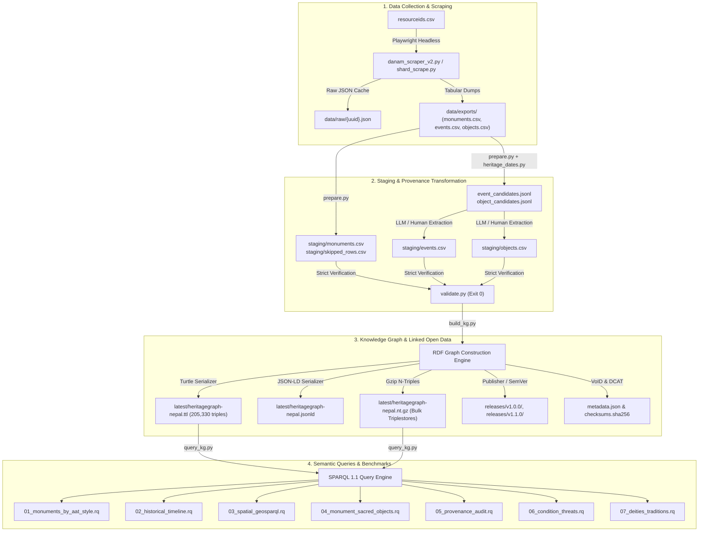
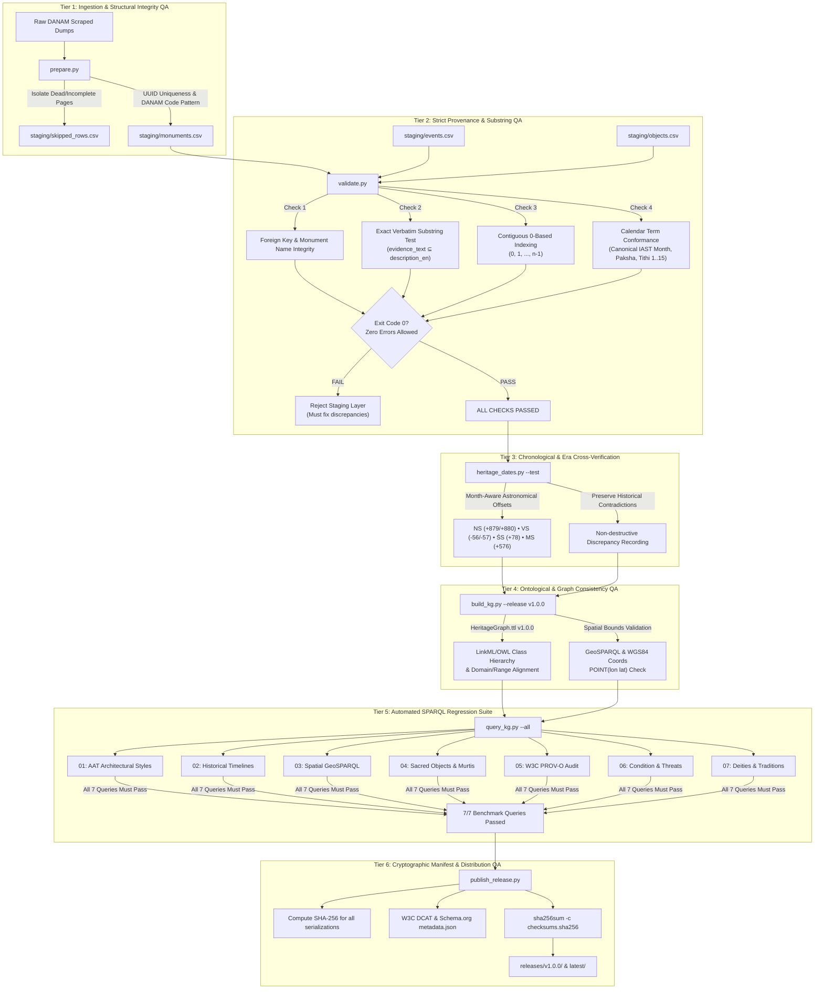

# CAIR-Nepal HeritageGraphDataset

[](https://cair-nepal.org/heritagegraph/)
[](http://www.cidoc-crm.org/cidoc-crm/)
[](http://www.w3.org/ns/prov#)
[](http://vocab.getty.edu/aat/)
[](https://www.w3.org/TR/turtle/)
[](https://www.python.org/)

An authoritative, provenance-preserving cultural heritage dataset and Linked Open Data (LOD) Knowledge Graph for Nepal.
This project ingests monument reports scraped from the **Digital Archive of Nepalese Arts and Monuments (DANAM)**
(`danam.cats.uni-heidelberg.de`), normalizes inscriptional calendars and architectural typologies into structured staging
tables, and synthesizes standards-compliant RDF Knowledge Graphs aligned with the **CAIR-Nepal HeritageGraph Ontology (v1.0.0)**,
**CIDOC-CRM (v7.1.2)**, **W3C PROV-O**, **Getty AAT**, and **GeoSPARQL**.

---

## Table of Contents
- [1. Architecture & Pipeline](#1-architecture--pipeline)
- [2. Repository Structure](#2-repository-structure)
- [3. Installation & Environment](#3-installation--environment)
- [4. Pipeline Stage 1: Data Collection (Scraping)](#4-pipeline-stage-1-data-collection-scraping)
- [5. Pipeline Stage 2: Staging & Provenance Transformation](#5-pipeline-stage-2-staging--provenance-transformation)
- [6. Pipeline Stage 3: Knowledge Graph (KG) Construction](#6-pipeline-stage-3-knowledge-graph-kg-construction)
- [7. Pipeline Stage 4: SPARQL Analytics & Benchmark Queries](#7-pipeline-stage-4-sparql-analytics--benchmark-queries)
- [8. Antigravity Skill (`danam-to-heritagegraph`)](#8-antigravity-skill-danam-to-heritagegraph)
- [9. Ontological Foundations & Namespaces](#9-ontological-foundations--namespaces)
- [10. Script Reference & CLI Help](#10-script-reference--cli-help)
- [11. Quality Assurance (QA) & Verification Lifecycle](#11-quality-assurance-qa--verification-lifecycle)

---

## 1. Architecture & Pipeline



---

## 2. Repository Structure

```text
HeritageGraphDataset/
├── ontology/                             # Official CAIR-Nepal HeritageGraph Ontology
│   └── HeritageGraph.ttl                 # Authoritative LinkML/OWL RDF ontology definition (v1.0.0)
├── latest/                               # Rolling mirror of the most recent stable release
│   ├── heritagegraph-nepal.ttl           # W3C Turtle RDF graph (221,364 triples)
│   ├── heritagegraph-nepal.jsonld        # JSON-LD serialization (Schema.org / Web LOD)
│   ├── heritagegraph-nepal.nt.gz         # Gzipped N-Triples (7.18 MB for bulk triplestores)
│   ├── metadata.json                     # DCAT / Schema.org dataset metadata & statistics
│   └── checksums.sha256                  # SHA-256 cryptographic integrity hashes
├── releases/                             # Archival versioned releases (immutable)
│   ├── v1.0.0/                           # Initial stable release (October 2026)
│   │   ├── heritagegraph-nepal.ttl
│   │   ├── heritagegraph-nepal.jsonld
│   │   ├── heritagegraph-nepal.nt.gz
│   │   ├── metadata.json
│   │   └── checksums.sha256
│   └── v1.1.0/                           # Next scheduled release (Roadmap)
├── .agents/
│   └── skills/
│       └── danam-to-heritagegraph/     # Standard Antigravity agent skill
│           ├── SKILL.md                 # Workflow runbook & agent instructions
│           ├── references/              # Specifications & ground-truth mappings
│           │   ├── column_spec.md       # Exact staging schema & column definitions
│           │   ├── ontology_mapping.md  # Class mapping rules & Getty AAT styles
│           │   └── worked_example.md    # Worked ground-truth example (Jogeśvara Mandira)
│           └── scripts/                 # Core automation tools (cross-platform, UTF-8 hardened)
│               ├── prepare.py           # Ingestion, typology mapping & candidate generator
│               ├── heritage_dates.py    # Date, era (NS, VS, ŚS, MS), & calendar parser
│               ├── validate.py          # Strict staging CSV validator
│               ├── build_kg.py          # RDF Knowledge Graph builder & LOD exporter
│               ├── publish_release.py   # Release publisher and checksum generator
│               └── query_kg.py          # SPARQL query execution runner
├── data_collection/                     # Scraper subsystem
│   ├── danam_scraper_v2.py              # Main Playwright scraping & export engine
│   ├── shard_scrape.py                  # Distributed multi-process shard runner
│   ├── main.py                          # Data collection CLI dispatcher
│   ├── resourceids.csv                  # Catalog of DANAM monument IDs
│   ├── pyproject.toml                   # Scraper dependencies
│   └── data/
│       ├── raw/                         # Scraped JSON records (one per monument UUID)
│       └── exports/                     # Raw CSV exports (monuments.csv, events.csv, objects.csv)
├── queries/                             # Standard SPARQL benchmark suite (*.rq)
│   ├── 01_monuments_by_aat_style.rq     # Getty AAT architectural style classification
│   ├── 02_historical_timeline.rq        # Multi-era chronological historical event timeline
│   ├── 03_spatial_geosparql.rq          # GeoSPARQL & WGS84 spatial distribution
│   ├── 04_monument_sacred_objects.rq    # Sacred objects, murtis, and architectural elements
│   ├── 05_provenance_audit.rq           # W3C PROV-O provenance, sources, & evidence audit
│   ├── 06_condition_threats.rq          # Conservation assessments & identified threats
│   └── 07_deities_traditions.rq         # Religious traditions & primary deities
├── staging/                             # Active staging datasets and candidates
│   ├── monuments.csv                    # Ingested monuments with derived ontology columns
│   ├── skipped_rows.csv                 # Catalog of dead/empty records
│   ├── event_candidates.jsonl           # Pre-filtered candidate sentences for events
│   └── object_candidates.jsonl          # Pre-filtered candidate mentions for objects
├── build_kg.py                          # Root convenience wrapper for Knowledge Graph construction
├── publish_release.py                   # Root utility for versioned release publishing & verification
├── query_kg.py                          # Root convenience wrapper for SPARQL query execution
├── RELEASES.md                          # Detailed release architecture, versioning & roadmap
├── skill/
│   └── danam-to-heritagegraph.skill     # Standard packaged ZIP distribution of the skill
├── AGENTS.md                            # Operational rules & guidelines for AI agents
└── README.md                            # Comprehensive repository documentation (this file)
```

---

## 3. Installation & Environment

### Prerequisites
- **Python**: Version 3.11 or later
- **Package Manager**: Standard `pip` or [`uv`](https://github.com/astral-sh/uv) (recommended)
- **Operating System**: Linux, macOS, or Windows (Windows console UTF-8 stream handling is built-in)

### Dependencies
Install the required packages:
```bash
# Core RDF Knowledge Graph & SPARQL dependencies:
pip install rdflib

# Scraper dependencies (if performing data collection):
pip install playwright beautifulsoup4 lxml
playwright install chromium
```

Or using `uv` without global installation:
```bash
# Run commands directly with rdflib
uv run --with rdflib python build_kg.py --help
uv run --with rdflib python query_kg.py --all
```

---

## 4. Pipeline Stage 1: Data Collection (Scraping)

The scraper retrieves JavaScript-rendered monument pages from DANAM using Playwright headless Chromium.

### Running a Test Scrape
```bash
cd data_collection
python danam_scraper_v2.py --csv resourceids.csv --out data/raw --limit 5
```

### Running Distributed Shards
To parallelize scraping across multiple terminals:
```bash
# Terminal 1: Shard 0 of 4
python shard_scrape.py --csv resourceids.csv --out data/raw --shard 0 --total-shards 4

# Terminal 2: Shard 1 of 4
python shard_scrape.py --csv resourceids.csv --out data/raw --shard 1 --total-shards 4
```
Each shard maintains an independent checkpoint file (`checkpoint_shard_N.txt`) and is fully idempotent.

### Exporting Scraped Data to CSV
Once JSON files are written to `data/raw/`:
```bash
python danam_scraper_v2.py --csv resourceids.csv --out data/raw --export-only --export-dir data/exports
```
This produces three flat tabular files:
1. `data/exports/monuments.csv` (46 raw attributes)
2. `data/exports/events.csv` (tabular historical events, FK: `resource_id`)
3. `data/exports/objects.csv` (tabular objects and elements, FK: `resource_id`)

---

## 5. Pipeline Stage 2: Staging & Provenance Transformation

### Ingestion & Candidate Preparation (`prepare.py`)
Run `prepare.py` on the raw monuments export:
```bash
python .agents/skills/danam-to-heritagegraph/scripts/prepare.py --input data_collection/data/exports/monuments.csv --outdir staging
```
**What `prepare.py` does:**
1. Preserves all 46 original DANAM columns verbatim.
2. Isolates dead pages into `skipped_rows.csv`.
3. Appends normalized ontology columns:
   - `danam_code`: e.g. `SKH0510` (extracted from `name_devanagari`).
   - `name_ne`: Devanagari monument name with the code stripped.
   - `ontology_class`: e.g. `Temple`, `Chaitya`, `Stupa`, `Pati`, `Sattal`, `DhungeDhara`.
   - `aat_style`: Getty AAT architectural style (e.g. `aat:300004829` for Pagoda, `aat:300446671` for Shikhara).
   - `condition_types`: Normalized status (`Good`, `Damaged`, `Ruined`, `Restored`).
   - `mapping_notes`: Flags for manual review.
4. Generates `event_candidates.jsonl` and `object_candidates.jsonl` containing extracted sentences, inscriptional dates, object IDs, and citations.

### Date Parsing & Lunisolar Verification (`heritage_dates.py`)
`heritage_dates.py` parses free text for Nepali era dates, months, lunar fortnights (paksha), and tithis, pairing them with CE years:
```bash
# Parse arbitrary text from CLI
python .agents/skills/danam-to-heritagegraph/scripts/heritage_dates.py "On the 13th of the bright fortnight of Phālguna in 1689 CE (NS 809)"

# Run internal test suite
python .agents/skills/danam-to-heritagegraph/scripts/heritage_dates.py --test
```
**Era Conversion Offsets:**
| Era Name | Code | Base Offset to CE | Month-Aware Boundary |
|---|---|---|---|
| Nepāla Saṃvat | `NS` | +879 / +880 | Months Kārtika, Mārgaśīrṣa, Pauṣa = +879; others = +880 |
| Vikrama Saṃvat | `VS` / `BS` | -56 / -57 | Months Māgha, Phālguna, Caitra = -56; others = -57 |
| Śaka Saṃvat | `ŚS` / `SS` | +78 | Fixed +78 |
| Mānadeva Saṃvat | `MS` | +576 | Fixed +576 (approximate) |

### Strict Quality Validation (`validate.py`)
Run `validate.py` on the staging directory before Knowledge Graph ingestion:
```bash
python .agents/skills/danam-to-heritagegraph/scripts/validate.py --dir staging
```
The validator strictly enforces:
- **Foreign Key Integrity**: Every `resource_id` and `monument_name` in `events.csv` and `objects.csv` must match `monuments.csv` verbatim.
- **Substring Provenance**: `evidence_text` must be an exact verbatim substring of the monument's `description_en`.
- **Sequential Indexing**: `event_index` and `object_index` must be 0-based and contiguous (0..n-1).
- **Calendar Conformance**: Canonical month spellings (`Phālguna`, `Māgha`, etc.), `paksha` (`Śukla` or `Kṛṣṇa`), and `tithi` (1..15).
- **Exit Code**: Exits `0` only when zero errors remain.

---

## 6. Pipeline Stage 3: Knowledge Graph (KG) Construction & Releases

The Knowledge Graph builder transforms staging CSVs into a formal RDF graph aligned with international ontology standards. Releases are versioned following Semantic Versioning (SemVer-KG) and mirrored to `latest/`. See [RELEASES.md](file:///c:/Users/nabin/Desktop/myall/heritageGraphDataset/HeritageGraphDataset/RELEASES.md) for full details.

### Building & Publishing Releases
```bash
# Build knowledge graph and publish a versioned release (updates latest/ automatically):
python publish_release.py --version v1.0.0

# Build and publish a new version directly from staging CSVs:
python publish_release.py --version v1.1.0 --rebuild --dir staging

# Alternatively, publish using the build_kg.py wrapper:
python build_kg.py --dir staging --release v1.0.0

# Fast testing on a subset of 50 monuments:
python build_kg.py --dir staging --sample 50 --outdir lod_export
```

### Knowledge Graph Metrics (`v1.0.0` / `latest`)
- **Total RDF Triples**: **221,364**
- **Monuments / Structures**: **1,652** (730 Temples, 273 Patis, 132 DhungeDharas, 101 Sattals, 71 Chaityas)
- **Historical Events**: **5,098** (1,996 HistoricalEvents, 1,808 Productions, 1,592 Assessments, 695 Destructions)
- **Sacred Objects**: **7,160** (1,570 IconographicObjects, 1,542 Murtis, 292 ArchitecturalElements, 3,748 HumanMadeObjects)
- **Geographic Places**: **1,021**
- **Documented Deities**: **355**
- **Point Geometries**: **1,626**

### Release Distribution Artifacts
All releases and `latest/` contain:
- `heritagegraph-nepal.ttl`: Human-readable Turtle serialization (18.60 MB)
- `heritagegraph-nepal.jsonld`: Schema.org-compatible JSON-LD (33.74 MB)
- `heritagegraph-nepal.nt.gz`: Streaming Gzipped N-Triples for triplestores (7.18 MB)
- `metadata.json`: Machine-readable DCAT / Schema.org metadata and statistics (3.90 KB)
- `checksums.sha256`: Cryptographic SHA-256 verification manifest

```bash
# Verify integrity of downloaded release files:
cd latest/
sha256sum -c checksums.sha256
```

---

## 7. Pipeline Stage 4: SPARQL Analytics & Benchmark Queries

The repository includes 7 standard benchmark SPARQL queries located in `queries/`:

| Query File | Description | Ontological Alignment |
|---|---|---|
| `01_monuments_by_aat_style.rq` | Classifies monuments by Getty AAT architectural style (Pagoda, Shikhara, Stupa, Chaitya, Dome). | `hg:hasArchitecturalStyle`, `aat:` |
| `02_historical_timeline.rq` | Extracts chronological event timelines across Licchavi, Malla, Shah, and Rana periods. | `crm:E5_Event`, `hg:period`, `hg:inscriptionalDateEra` |
| `03_spatial_geosparql.rq` | Queries spatial coordinates (WGS84 lat/lon) and administrative locations (districts, municipalities). | `geo:lat`, `geo:long`, `geosparql:asWKT` |
| `04_monument_sacred_objects.rq` | Identifies sacred objects, murtis, toranas, bells, and architectural components per monument. | `crm:P46_is_composed_of`, `hg:Murti`, `hg:material` |
| `05_provenance_audit.rq` | Audits W3C PROV-O provenance, primary source citations, and verbatim evidence text. | `prov:wasDerivedFrom`, `prov:wasAttributedTo`, `dcterms:source` |
| `06_condition_threats.rq` | Analyzes physical condition assessments and identified threats (earthquakes, erosion, encroachment). | `crm:E14_Condition_Assessment`, `hg:conditionStatus` |
| `07_deities_traditions.rq` | Maps religious traditions (Hinduism, Buddhism, etc.) and primary enshrined deities. | `hg:Deity`, `hg:hasReligiousTradition` |

### Running Queries with `query_kg.py`
```bash
# Execute all 7 benchmark queries with formatted table output:
python query_kg.py --all

# Execute a single benchmark query:
python query_kg.py --query queries/01_monuments_by_aat_style.rq

# Export query results as JSON or CSV:
python query_kg.py --query queries/02_historical_timeline.rq --format json
python query_kg.py --query queries/03_spatial_geosparql.rq --format csv

# Execute an arbitrary inline SPARQL query:
python query_kg.py --sparql "SELECT ?m ?name WHERE { ?m a hg:Temple ; rdfs:label ?name } LIMIT 10"
```

---

## 8. Antigravity Skill (`danam-to-heritagegraph`)

This repository is equipped with an official Antigravity skill located at `.agents/skills/danam-to-heritagegraph/`.

### Structure
- **`SKILL.md`**: Main instruction runbook containing step-by-step guidance, rules, and commands.
- **`references/`**: Authoritative specifications:
  - `column_spec.md`: Column-by-column formatting rules.
  - `ontology_mapping.md`: Mapping tables from keywords to ontology classes.
  - `worked_example.md`: Complete worked example of Jogeśvara Mandira.
- **`scripts/`**: Hardened, self-contained Python scripts for date parsing, candidate extraction, validation, KG building, and querying.
- **`skill/danam-to-heritagegraph.skill`**: Pre-packaged ZIP archive for one-click installation into external Antigravity environments.

### How the Agent Uses the Skill
When an agent is asked to "transform heritage data", "extract events from descriptions", "parse NS/VS dates", or "build the knowledge graph", Antigravity automatically activates this skill and follows its standardized runbook.

---

## 9. Ontological Foundations & Namespaces

The dataset merges domain-specific cultural concepts with international standards:

```turtle
@prefix hg:            <https://cair-nepal.org/heritagegraph/> .
@prefix heritageGraph: <https://cair-nepal.org/heritagegraph/> .
@prefix crm:           <http://www.cidoc-crm.org/cidoc-crm/> .
@prefix prov:          <http://www.w3.org/ns/prov#> .
@prefix aat:           <http://vocab.getty.edu/aat/> .
@prefix geo:           <http://www.w3.org/2003/01/geo/wgs84_pos#> .
@prefix geosparql:     <http://www.opengis.net/ont/geosparql#> .
@prefix schema:        <https://schema.org/> .
@prefix void:          <http://rdfs.org/ns/void#> .
@prefix dcat:          <http://www.w3.org/ns/dcat#> .
@prefix dcterms:       <http://purl.org/dc/terms/> .
@prefix res:           <https://data.cairnepal.org/heritage/resource/> .
```

### Core Entity Class Mappings
- **Monuments**: `hg:ArchitecturalStructure` (specialized into `hg:ReligiousStructure`, `hg:RestHouse`, `hg:WaterStructure`, with leaf classes `hg:Temple`, `hg:Stupa`, `hg:Chaitya`, `hg:Pati`, `hg:Sattal`, `hg:Dharmashala`, `hg:DhungeDhara`, `hg:Pokhari`).
- **Events**: `crm:E5_Event` (specialized into `crm:E12_Production`, `crm:E6_Destruction`, `crm:E10_Transfer_of_Custody`, `crm:E14_Condition_Assessment`, `hg:RitualEvent`, `hg:Consecration`, `hg:Enshrinement`, `hg:HistoricalEvent`).
- **Objects**: `crm:E22_Human-Made_Object` (specialized into `hg:IconographicObject`, `hg:Murti`, `hg:Paubha`, `hg:ArchitecturalElement`, `hg:PhysicalHeritageThing`).
- **Geography**: `crm:E53_Place`, `geo:SpatialThing`, `geosparql:Geometry`.
- **Provenance**: `prov:Entity`, `prov:Activity`, `prov:Agent`, `prov:SoftwareAgent`.

---

## 10. Script Reference & CLI Help

Every script in this repository is hardened, cross-platform, supports `--help`, and handles Windows console UTF-8 stream re-encoding:

| Script | Location | Key Arguments | Purpose |
|---|---|---|---|
| `prepare.py` | `.agents/skills/.../scripts/` | `--input <csv>`, `--outdir <dir>` | Ingests raw CSV and prepares staging files and candidates. |
| `heritage_dates.py` | `.agents/skills/.../scripts/` | `[text]`, `--file <file>`, `--test`, `--compact` | Extracts inscriptional dates, converts eras to CE, and parses lunisolar calendar terms. |
| `validate.py` | `.agents/skills/.../scripts/` | `--dir <staging_dir>` | Strictly validates staging CSV foreign keys, indices, and verbatim evidence text. |
| `build_kg.py` | Root & `.agents/skills/.../scripts/` | `--dir <dir>`, `--release <ver>`, `--formats <fmt>`, `--sample <n>` | Builds RDF Knowledge Graph from staging CSVs and optionally publishes a release. |
| `publish_release.py`| Root & `.agents/skills/.../scripts/` | `--version <ver>`, `--from-existing-ttl <f>`, `--rebuild` | Packages standardized releases, generates SHA-256 manifests, and syncs `latest/`. |
| `query_kg.py` | Root & `.agents/skills/.../scripts/` | `--all`, `--query <file.rq>`, `--sparql <query>`, `--format <table\|json\|csv>` | Executes SPARQL queries against the generated Knowledge Graph. |
| `danam_scraper_v2.py`| `data_collection/` | `--csv <file>`, `--out <dir>`, `--limit <n>`, `--export-only` | Playwright scraper that extracts monument pages into JSON and exports flat CSVs. |
| `shard_scrape.py` | `data_collection/` | `--csv <file>`, `--shard <id>`, `--total-shards <n>` | Multi-process shard runner for parallelized scraping. |

---

## 11. Quality Assurance (QA) & Verification Lifecycle

HeritageGraph enforces a multi-tier, zero-tolerance Quality Assurance (QA) lifecycle. Every release must pass all validation gates before publication to ensure strict provenance, epistemological honesty, and standards compliance.

### QA Pipeline Architecture



### Detailed QA Tiers & Verification Gates

| QA Tier | Verification Scope | Tool / Script | Enforcement Criteria & Pass Conditions |
|---|---|---|---|
| **Tier 1: Ingestion QA** | Raw scraping dumps | `prepare.py` | • Deduplicates rows by monument UUID (`resource_id`).<br>• Validates DANAM code structure (`[A-Z]{3}\d{4}`).<br>• Segregates incomplete or dead pages to `skipped_rows.csv`. |
| **Tier 2: Provenance QA** | Staging CSV tables | `validate.py` | • **Exact Substring Rule**: `evidence_text` MUST be an exact character-for-character substring of `description_en`. Rephrased text fails validation.<br>• **Foreign Key Integrity**: Every event and object row must reference a valid `resource_id` and verbatim `monument_name`.<br>• **Contiguous Indexing**: `event_index` and `object_index` must be 0-based and sequential ($0, 1, \dots, n-1$) without gaps.<br>• **Calendar Conformance**: Month names must match canonical IAST forms (`Phālguna`, `Māgha`, etc.), `paksha` must be `Śukla` or `Kṛṣṇa`, and `tithi` must be integer $1 \le t \le 15$. |
| **Tier 3: Chronological QA** | Historical date claims | `heritage_dates.py` | • Converts inscriptional dates using astronomical boundary-aware offsets (e.g. NS $+879$ for Kārtika–Pauṣa, $+880$ otherwise).<br>• Detects era-CE internal contradictions in sources without altering source testimony. |
| **Tier 4: Ontological QA** | RDF Knowledge Graph | `build_kg.py` | • Validates against authoritative `ontology/HeritageGraph.ttl` (v1.0.0).<br>• Enforces LinkML/OWL class hierarchy (`ReligiousStructure`, `RestHouse`, `WaterStructure`).<br>• GeoSPARQL coordinate validation (WGS84 decimal lat/long within Nepal bounding box and WKT Point literals). |
| **Tier 5: SPARQL Regression** | Query capability | `query_kg.py --all` | • Executes all 7 canonical SPARQL benchmark queries in `queries/*.rq`.<br>• Validates that Getty AAT style classifications, multi-era timelines, and PROV-O provenance trails return valid result sets. |
| **Tier 6: Release QA** | Public distribution | `publish_release.py` | • Generates cryptographic SHA-256 hashes for all formats (`.ttl`, `.jsonld`, `.nt.gz`, `metadata.json`).<br>• Verifies checksum manifest using standard `sha256sum -c checksums.sha256`.<br>• Validates DCAT & Schema.org `metadata.json` entity statistics and byte sizes. |

### Core Epistemological Invariants

Every automated pipeline and human curator adheres to four core invariants:

1. **"Blank Beats Guessed"**: Never extrapolate or hallucinate dates, actors, materials, or deities. If the source is silent, leave the field blank.
2. **Unbroken Substring Provenance**: Every extracted statement must link to the verbatim sentence in `description_en`. This ensures that downstream users can audit every fact back to the primary literature.
3. **Non-Destructive Contradiction Preservation**: When historical sources contradict each other or state impossible dates (e.g. `ŚS 1422 (i.e., 500 CE)`), keep the written values as-is, detail the contradiction in `event_description`, and flag the record rather than silently modifying it.
4. **No Artificial Metric Padding**: The number of extracted rows need not match the DANAM database counters (`event_count`, `object_count`). Page counters reflect internal database rows, whereas narrative prose covers only documented facts.

---

## License & Attribution

This dataset and codebase are developed by **CAIR-Nepal** (Centre for Artificial Intelligence Research Nepal).
Monument reports and source materials originate from the **Digital Archive of Nepalese Arts and Monuments (DANAM)**, Heidelberg University (`danam.cats.uni-heidelberg.de`).
Distributed for academic research, cultural preservation, and natural language processing.