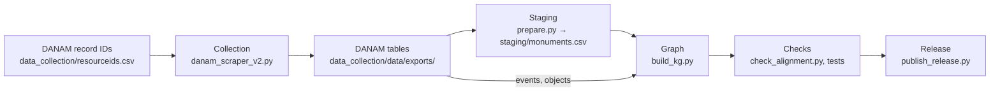

# HeritageGraph-Nepal

A knowledge graph of 1,652 monuments of Nepal (temples, rest houses, water structures, Buddhist monastic
buildings and others), built from the monument records of the
[Digital Archive of Nepalese Arts and Monuments (DANAM)](https://danam.cats.uni-heidelberg.de), Heidelberg University.
The graph uses the [HeritageGraph ontology](https://github.com/CAIRNepal/heritagegraphontology) (CAIR-Nepal), which is
aligned with CIDOC-CRM and PROV-O, and is validated against the ontology's SHACL shapes. This repository holds the data,
the pipeline that builds it, and the checks that measure its conformance.

> **Status.** The published release is **v1.0.0** (`releases/v1.0.0/`, mirrored in `latest/`). It was built before the
> alignment with the ontology described below. The builder on `main` produces the aligned graph; the next release will be
> built from it. Numbers in this README refer to the builder on `main` unless marked v1.0.0.

---

## Contents

1. [What the graph contains](#1-what-the-graph-contains)
2. [Data model](#2-data-model)
3. [Conformance with the ontology](#3-conformance-with-the-ontology)
4. [Files and downloads](#4-files-and-downloads)
5. [Quick start](#5-quick-start)
6. [How the graph is built](#6-how-the-graph-is-built)
7. [Repository layout](#7-repository-layout)
8. [Limitations](#8-limitations)
9. [Licence and source rights](#9-licence-and-source-rights)
10. [Citation](#10-citation)

---

## 1. What the graph contains

| | count | notes |
|---|---|---|
| Triples | 224,853 | builder on `main`; release v1.0.0 has 221,364 |
| Monuments | 1,652 | 730 temples, 273 patis (rest houses), 215 Buddhist monastic buildings, 132 water structures (dhunge dhara), 101 sattals, 71 chaityas; a monument can have more than one type |
| Events | 5,098 | 1,996 historical events, 1,808 productions, 695 destructions, 284 transfers of custody, 300 ritual events (128 consecrations, 87 enshrinements), 15 condition assessments |
| Objects | 7,160 | 3,120 iconographic objects (1,543 murtis, 6 paubhas), 292 architectural elements, 3,748 other human-made objects |
| Condition assessments | 1,577 | one per monument that DANAM assesses |
| Places | 1,174 | administrative hierarchy: province, district, municipality, tola |
| Deities | 355 | main deities named by DANAM |
| Point geometries | 1,626 | WGS84 coordinates and GeoSPARQL WKT points |

Source: DANAM's monument records, collected on 16 March 2026. Of 1,947 listed record IDs, 1,937 records were collected;
285 of them are empty and are listed in `staging/skipped_rows.csv`, leaving 1,652 monuments.

## 2. Data model

Each DANAM record becomes one monument with its names, identifiers, location, architectural attributes, condition,
events and objects. Every monument links to the DANAM page it was derived from.

| DANAM content | Modelled as |
|---|---|
| monument | `hg:ArchitecturalStructure` and its subclasses (`hg:Temple`, `hg:Pati`, `hg:Sattal`, `hg:Chaitya`, `hg:DhungeDhara` …); also `crm:E22_Human-Made_Object` |
| names | `rdfs:label` (one English label as a plain string), `skos:prefLabel` (`@en`, `@ne`), `schema:alternateName` |
| DANAM resource ID, DANAM code, object number | `crm:P1_is_identified_by` → `crm:E42_Identifier` with `crm:P190_has_symbolic_content`; the kind of identifier on `crm:P2_has_type` |
| location | `crm:P55_has_current_location` → `crm:E53_Place`; places nest through `crm:P89_falls_within`, with `hg:placeType` (province, district, municipality, tola) |
| coordinates | `geo:lat`, `geo:long`; `geosparql:hasGeometry` → WKT point |
| architectural style | `hg:hasArchitecturalStyle` → ontology style value (one per monument); the Getty AAT concept on `crm:P2_has_type` |
| roof type, brick type, ground-plan shape | `crm:P2_has_type` → `crm:E55_Type` concepts, one per value DANAM lists |
| storeys, roofs | `hgn:numberOfStoreys`, `hgn:numberOfRoofs` |
| condition | `crm:P34i_was_assessed_by` → `crm:E14_Condition_Assessment` → `crm:P35_has_identified` → `crm:E3_Condition_State` with `hg:hasConditionType`; threats on `hgn:identifiedThreats` |
| events | `crm:E5_Event` and its subclasses, linked by `crm:P12_occurred_in_the_presence_of` / `crm:P12i_was_present_at` |
| objects | architectural parts by `crm:P46_is_composed_of`; other objects housed in the monument by `hgn:containsObject` |
| main deity | `hgn:hasMainDeity` → `hg:Deity` |
| provenance | `prov:wasDerivedFrom` → the DANAM page (`prov:Entity`); `prov:generatedAtTime` (collection time) |

**Namespaces**

```turtle
@prefix hg:   <https://cair-nepal.org/heritagegraph/> .                 # HeritageGraph ontology
@prefix hgn:  <https://w3id.org/heritagegraph-nepal/vocab#> .           # this dataset's extension vocabulary (provisional IRI)
@prefix res:  <https://data.cairnepal.org/heritage/resource/> .         # instances
@prefix crm:  <http://www.cidoc-crm.org/cidoc-crm/> .
@prefix prov: <http://www.w3.org/ns/prov#> .
@prefix aat:  <http://vocab.getty.edu/aat/> .
@prefix geo:  <http://www.w3.org/2003/01/geo/wgs84_pos#> .
@prefix geosparql: <http://www.opengis.net/ont/geosparql#> .
@prefix skos: <http://www.w3.org/2004/02/skos/core#> .
@prefix schema: <https://schema.org/> .
```

## 3. Conformance with the ontology

The dataset ships the exact files of the ontology version it targets, **HeritageGraph 1.0.1** (`ontology/`; source commit
and SHA-256 in [`ontology/SOURCE.md`](ontology/SOURCE.md)). `tools/sync/check_alignment.py` measures two things on a
built graph:

- **Undeclared terms: 0.** Every `hg:` class, property and value used is declared in the ontology. Eleven terms the
  ontology does not have are defined in the dataset's extension vocabulary [`vocab/hgn.ttl`](vocab/hgn.ttl); each states
  the closest CIDOC-CRM or HeritageGraph term (`rdfs:subClassOf`, `rdfs:subPropertyOf` or `skos:closeMatch`).
- **SHACL: 4,012 results** (v1.0.0: 75,641), in two groups:

| results | shape rule | reason |
|---|---|---|
| 3,812 | `hg:hasReligiousTradition` must be an IRI of class `hg:ReligiousTradition` | the religious traditions are still text; the mapping to concepts is prepared and awaits one decision (the DANAM value "Unspecified") |
| 200 | every `hg:Temple` has one `hg:hasArchitecturalStyle` | DANAM records no style for these 200 temples; ontology 1.1.0 adds the value "Not recorded" for this case |

Each change made for the alignment is logged with its test and before/after counts in
[`docs/sync/SYNC_LOG.md`](docs/sync/SYNC_LOG.md); the plan is in [`docs/sync/SYNC_PLAN.md`](docs/sync/SYNC_PLAN.md) and
the full report in [`docs/sync/alignment_after_sync.md`](docs/sync/alignment_after_sync.md).

## 4. Files and downloads

Each release directory (`releases/<version>/`, the latest mirrored in `latest/`) contains:

| file | content |
|---|---|
| `heritagegraph-nepal.ttl` | Turtle |
| `heritagegraph-nepal.jsonld` | JSON-LD |
| `heritagegraph-nepal.nt.gz` | gzipped N-Triples, for bulk loading into a triplestore |
| `metadata.json` | DCAT / Schema.org description of the release |
| `checksums.sha256` | SHA-256 of each file |

```bash
cd releases/v1.0.0 && sha256sum -c checksums.sha256   # macOS: shasum -a 256 -c checksums.sha256
```

Release policy and history: [RELEASES.md](RELEASES.md).

## 5. Quick start

Requirements: Python 3.11+ and [uv](https://github.com/astral-sh/uv) (or pip). The commands below use uv with the pinned
versions in `tools/sync/requirements.txt` (rdflib 7.6.0, pySHACL 0.40.1).

```bash
RUN="uv run --no-project --with-requirements tools/sync/requirements.txt python"

# Build the graph from the source tables into a scratch directory
$RUN build_kg.py --dir staging --outdir build/kg --formats turtle,nt

# Run the example SPARQL queries in queries/ (written for the graph built on main; v1.0.0 uses older terms)
$RUN query_kg.py --graph build/kg/heritage_graph.ttl --all
$RUN query_kg.py --graph build/kg/heritage_graph.ttl --query queries/03_spatial_geosparql.rq --format csv

# Check a built graph against the ontology (undeclared terms + SHACL)
$RUN tools/sync/check_alignment.py --graph build/kg/heritage_graph.nt --out build/kg/alignment

# Tests
$RUN -m pytest -q
```

Example queries (`queries/`):

| query | what it returns |
|---|---|
| `01_monuments_by_aat_style.rq` | monuments with their Getty AAT style concept and DANAM code |
| `02_historical_timeline.rq` | events per monument with type, period and era date where recorded |
| `03_spatial_geosparql.rq` | coordinates, WKT point, and district / municipality / tola |
| `04_monument_sacred_objects.rq` | objects per monument with class, DANAM number, material and position |
| `05_provenance_audit.rq` | monument, event, attributed agent and DANAM page |
| `06_condition_threats.rq` | condition values, threats and assessment text |
| `07_deities_traditions.rq` | main deity and religious tradition per monument |

## 6. How the graph is built



1. **Collection** (`data_collection/`). A Playwright scraper reads each DANAM record page (2–4 s between requests) and
   writes one JSON file per record, then exports three tables: `monuments.csv` (46 fields), `events.csv` and
   `objects.csv`.
   ```bash
   cd data_collection
   python danam_scraper_v2.py --csv resourceids.csv --out data/raw --limit 5                 # collect
   python danam_scraper_v2.py --csv resourceids.csv --out data/raw --export-only --export-dir data/exports
   ```
2. **Staging** (`.agents/skills/danam-to-heritagegraph/scripts/prepare.py`). Keeps the 46 DANAM fields unchanged and adds
   derived columns: DANAM code, Nepali name, ontology class, Getty AAT style, normalised condition values. Empty records go
   to `staging/skipped_rows.csv`. Events and objects are taken from DANAM's own tables
   (`data_collection/data/exports/`); the builder uses them when `staging/` has no `events.csv` / `objects.csv`.
3. **Graph** (`build_kg.py`). Turns the tables into RDF as described in [§2](#2-data-model). Values are written as DANAM
   gives them; a value DANAM does not give is left out. Where the ontology allows one value but DANAM lists several (an
   architectural style, a condition type), the first is used and the others are kept in a note.
4. **Checks.** `tools/sync/check_alignment.py` (undeclared terms, SHACL against the ontology's shapes) and the tests in
   `tests/`.
5. **Release** (`publish_release.py`). Writes the serialisations, `metadata.json` and checksums to `releases/<version>/`
   and mirrors them to `latest/`.

The same pipeline is packaged as an agent skill in `.agents/skills/danam-to-heritagegraph/` (runbook in `SKILL.md`; the
scripts there are kept identical to the ones at the repository root).

## 7. Repository layout

```text
├── ontology/                HeritageGraph ontology 1.0.1: OWL, SHACL shapes, LinkML source; SOURCE.md; archive/ (1.0.0)
├── vocab/hgn.ttl            extension vocabulary for terms the ontology does not declare
├── releases/v1.0.0/         published release (immutable)
├── latest/                  copy of the latest release
├── data_collection/         scraper, DANAM record IDs, collected records (data/raw/) and tables (data/exports/)
├── staging/                 staged monument table, skipped records, candidate sentences
├── queries/                 example SPARQL queries
├── build_kg.py              graph builder
├── query_kg.py              SPARQL runner
├── publish_release.py       release writer
├── tools/sync/              conformance checker, pinned requirements, per-change check script
├── tests/                   tests (pytest)
├── docs/sync/               alignment plan, change log and reports
├── .agents/skills/danam-to-heritagegraph/   the pipeline as an agent skill (runbook, references, scripts)
├── RELEASES.md              release policy
└── AGENTS.md                rules for automated agents working in this repository
```

## 8. Limitations

- **No event dates.** DANAM's event tables, as collected, carry no dates, so no event in the graph has a date. Dates
  appear in DANAM's descriptive text; they are not yet extracted.
- **Event and object types are assigned by keyword rules** (`classify_event`, `classify_object` in `build_kg.py`), not by
  hand. They have not yet been evaluated against a manual sample; some are known to be wrong (e.g. renovations typed as
  destruction).
- **Place names are not normalised.** The same municipality can appear under two spellings (e.g. "Lalitpur" and "Lalitpur
  Metropolitan City"), and records that omit a level (often the district) give separate place nodes.
- **Source quirks are kept, not corrected.** Two records share the DANAM code `NWK0410`; DANAM reuses six object numbers
  for two objects each (each object keeps its own node); 24 half-storey values (1.5, 2.5, 4.5) are not written.
- **Coverage follows DANAM**, which documents mainly the Kathmandu Valley (1,433 of the 1,652 records are in Province 3).
- **Instance IRIs** (`https://data.cairnepal.org/heritage/resource/…`) do not yet resolve, and the extension vocabulary's
  IRI is provisional.
- **Provenance attribution.** The graph attributes events and objects to a software agent; this will be revised.
- **`metadata.json` of v1.0.0** counts monuments among the objects and lists a licence that differs from the one in the
  graph; this will be corrected in the next release.

## 9. Licence and source rights

> **TODO (authors):** choose and state the licence of the data (e.g. CC BY-SA 4.0, matching DANAM's deposit) and of the
> code (e.g. Apache-2.0), add a `LICENSE` file, and state the permission obtained from DANAM.

The monument records, descriptions and images are the work of DANAM, Heidelberg University
(<https://danam.cats.uni-heidelberg.de>). Every monument in the graph links to the DANAM page it was derived from.
Users should credit DANAM as the source of the content.

## 10. Citation

> **TODO (authors):** add the dataset DOI (e.g. Zenodo), the author list and a `CITATION.cff`.

If you use the ontology, cite it as given in the
[ontology repository](https://github.com/CAIRNepal/heritagegraphontology/blob/main/CITATION.cff).

---

Maintained by [CAIR-Nepal](https://cair-nepal.org). Issues and questions: use the repository's issue tracker.
