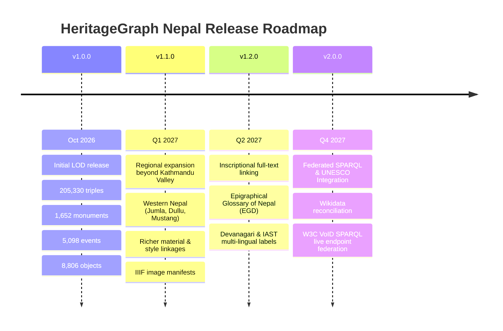

# HeritageGraph Nepal — Releases & Dataset Distribution

This document defines the release architecture, versioning policy, operational procedures for publishing dataset releases, and future roadmap for the **HeritageGraph Nepal** Knowledge Graph.

---

## 1. Distribution Directory Layout

All serialized Linked Open Data (LOD) distributions of the knowledge graph follow this standardized hierarchy:

```text
HeritageGraphDataset/
│
├── latest/                                     # Rolling mirror of the most recent stable release
│   ├── heritagegraph-nepal.ttl                 # Human-readable W3C Turtle serialization
│   ├── heritagegraph-nepal.jsonld              # JSON-LD serialization (Web / Schema.org friendly)
│   ├── heritagegraph-nepal.nt.gz               # Gzipped W3C N-Triples (optimized for triplestore bulk load)
│   ├── metadata.json                           # W3C DCAT & Schema.org dataset metadata and statistics
│   └── checksums.sha256                        # Cryptographic SHA-256 manifest of all distribution files
│
└── releases/                                   # Immutable, archival release directories
    ├── v1.0.0/                                 # Initial stable release (October 2026)
    │   ├── heritagegraph-nepal.ttl
    │   ├── heritagegraph-nepal.jsonld
    │   ├── heritagegraph-nepal.nt.gz
    │   ├── metadata.json
    │   └── checksums.sha256
    │
    └── v1.1.0/                                 # Next scheduled release (Roadmap)
        ├── heritagegraph-nepal.ttl
        ├── heritagegraph-nepal.jsonld
        ├── heritagegraph-nepal.nt.gz
        ├── metadata.json
        └── checksums.sha256
```

### File Specifications

| File Name | Format | MIME Type | Purpose / Best Used For |
| :--- | :--- | :--- | :--- |
| `heritagegraph-nepal.ttl` | W3C Turtle (`.ttl`) | `text/turtle` | Human-readable RDF with prefixes, ontology inspection, local querying via `query_kg.py`. |
| `heritagegraph-nepal.jsonld` | JSON-LD (`.jsonld`) | `application/ld+json` | Web applications, document databases, Schema.org crawlers, and JavaScript SPARQL clients. |
| `heritagegraph-nepal.nt.gz` | Gzip N-Triples (`.nt.gz`) | `application/gzip` | Streaming bulk loading into high-performance triplestores (Apache Jena Fuseki, Blazegraph, GraphDB, Virtuoso). Compresses ~42 MB down to ~6.7 MB. |
| `metadata.json` | JSON (DCAT/Schema.org) | `application/json` | Machine-readable dataset discovery: triple counts, entity stats, licenses, namespaces, and distribution checksums. |
| `checksums.sha256` | SHA-256 checksums | `text/plain` | Cryptographic integrity verification following standard `sha256sum` syntax. |

---

## 2. Current Release: `v1.0.0`

* **Release Date**: October 2026
* **Identifier**: `https://cair-nepal.org/heritagegraph/dataset/v1.0.0`
* **Ontology Alignment**: CAIR-Nepal HeritageGraph Ontology (`v1.0.0`), CIDOC-CRM (`v7.1.2`), W3C PROV-O, GeoSPARQL, Getty AAT.
* **Scope**: Comprehensive ingestion of Kathmandu Valley and regional monuments from DANAM (Digital Archive of Nepalese Arts and Monuments).

### Dataset Statistics (`v1.0.0`)

| Metric | Count | Description |
| :--- | :--- | :--- |
| **Total Triples** | **221,364** | Total statement count across the RDF graph |
| **Monuments / Structures** | **1,652** | Cataloged architectural monuments with unique coordinates and DANAM codes |
| **Historical Events** | **5,098** | Chronologically typed events (Production, Assessment, Destruction, Consecration, etc.) |
| **Sacred Objects** | **8,806** | Mūrtis, iconographic objects, architectural elements, and toranas (7,160 instances) |
| **Geographic Places** | **1,021** | Towns, toles, municipalities, and settlement nodes |
| **Documented Deities** | **355** | Canonical deities, bodhisattvas, and tutelary spirits |
| **Geometries** | **1,626** | Point geometries with WKT literals and WGS84 coordinates |

### Distribution Files & Verification (`v1.0.0`)

| File | Size | SHA-256 Checksum |
| :--- | :--- | :--- |
| `heritagegraph-nepal.ttl` | 18.60 MB | `e2f330cc02498fb45a3c9897401c3c09961af370db89a844e722a109384f3b1b` |
| `heritagegraph-nepal.jsonld` | 33.74 MB | `a1dc5d8701d9dba1b395ec0d581e43f7e34990d5b5a8b14dc93edfd99ca78bde` |
| `heritagegraph-nepal.nt.gz` | 7.18 MB | `b02d85a6fed6d6d41bb862c243bccc55e6f8627bad0b2306361de001a66d837a` |
| `metadata.json` | 3.90 KB | `b53ecd6d7e4bdf518f680c9998d50fba05c4db4e3400a2ea19f80aa67203b209` |

---

## 3. Semantic Versioning Policy for Knowledge Graphs

HeritageGraph adheres to **Semantic Versioning for Linked Data & Knowledge Graphs (SemVer-KG)**:

$$\text{Format: } \mathbf{v}\text{MAJOR}.\text{MINOR}.\text{PATCH}$$

### 1. MAJOR (`vX.0.0`) — Breaking Schema / Ontological Changes
Triggered when queries written against previous releases may break:
* Changing core namespace IRIs (e.g. prefix change or structural IRI redesign).
* Modifying class or property hierarchies in `heritageGraph` or CIDOC-CRM alignments.
* Removing previously existing RDF predicate relations or altering literal datatypes.

### 2. MINOR (`v1.X.0`) — Additive Data & Feature Expansions
Triggered when data is enriched in a fully backward-compatible manner:
* Ingesting newly surveyed monuments, regions, or inscriptions.
* Adding new optional properties (e.g. high-resolution image URLs, IIIF endpoints, audio recordings).
* Enhancing Getty AAT linkages, era conversions (NS, VS, ŚS, MS), or multi-lingual labels without altering existing IRIs.

### 3. PATCH (`v1.0.X`) — Errata & Corrective Fixes
Triggered when fixing erroneous statements without expanding scope:
* Correcting typos in verbatim textual labels or transliterations.
* Fixing coordinate drift or coordinate inversion (lat/long swapping).
* Adjusting single inscriptional date offsets based on newly published epigraphical scholarship.

---

## 4. Future Data Roadmap



### Planned for `v1.1.0`:
1. **Regional Ingestion**: Incorporate monuments cataloged from outside the Kathmandu Valley (e.g., Khasa Malla monuments of Jumla/Dullu, Gorkha, Mustang, and Janakpur).
2. **Media Linking**: Direct association with DANAM image archives and IIIF manifests for sacred objects (`Murti`, `Paubha`, `Toraṇa`).
3. **Condition & Threat Taxonomy**: Deeper structuring of earthquake vulnerabilities, decay mechanisms, and environmental threat classifications.

### Planned for `v1.2.0`:
1. **Epigraphical Alignments**: Explicit cross-referencing with DHARMA project and National Archives epigraphical registries.
2. **Multi-lingual Devanagari Labels**: Dual-script `rdfs:label` coverage in Sanskrit/Newari/Nepali (`ne`, `sa`, `new`) and romanized IAST (`sa-Latn`).

---

## 5. How to Publish a Release (Operational Runbook)

Publishing a release is fully automated via `publish_release.py` and `build_kg.py`.

### Option A: Publish from Existing Graph Exports

If `lod_export/heritage_graph.ttl` and `heritage_graph.nt` have already been generated:
```bash
python publish_release.py --version v1.1.0 \
  --from-existing-ttl lod_export/heritage_graph.ttl \
  --from-existing-nt lod_export/heritage_graph.nt \
  --notes "Release v1.1.0 adding Western Nepal regional monuments."
```

### Option B: Build and Publish from Staging CSVs in One Step

To rebuild the graph from `staging/` and generate the release:
```bash
python publish_release.py --version v1.1.0 --rebuild --dir staging
```
Or directly using `build_kg.py`:
```bash
python build_kg.py --dir staging --release v1.1.0
```

### What the Publishing Process Does Automatically:
1. Validates all inputs and serializes `heritagegraph-nepal.ttl`.
2. Serializes `heritagegraph-nepal.jsonld`.
3. Gzips N-Triples into `heritagegraph-nepal.nt.gz`.
4. Computes triple counts, class breakdowns, deity totals, and spatial metrics.
5. Generates Schema.org / DCAT-compliant `metadata.json`.
6. Computes SHA-256 hashes and creates `checksums.sha256`.
7. Atomically copies the release files to `latest/` (unless `--no-latest` is passed).

---

## 6. How to Verify Downloaded Artifacts

Always verify the integrity of the downloaded release files before loading into production:

### On Linux / macOS:
```bash
# Navigate to the release directory
cd latest/

# Verify against checksums
sha256sum -c checksums.sha256
```
Expected output:
```text
heritagegraph-nepal.ttl: OK
heritagegraph-nepal.jsonld: OK
heritagegraph-nepal.nt.gz: OK
metadata.json: OK
```

### On Windows (PowerShell):
```powershell
cd latest
Get-FileHash -Algorithm SHA256 heritagegraph-nepal.ttl, heritagegraph-nepal.jsonld, heritagegraph-nepal.nt.gz, metadata.json
```

---

## 7. Consuming Releases in Applications

### Using `latest/` (Always Up-to-Date):
To always query the latest stable dataset:
```python
import rdflib

g = rdflib.Graph()
g.parse("latest/heritagegraph-nepal.ttl", format="turtle")
print(f"Loaded {len(g):,} triples from latest release.")
```

Or run benchmark SPARQL queries:
```bash
# Automatically loads latest/heritagegraph-nepal.ttl
python query_kg.py --all
```

### Using Pinned Releases (For Reproducible Research):
Pin your code or analysis pipeline to a specific release to ensure 100% reproducibility in academic papers and production systems:
```bash
python query_kg.py --graph releases/v1.0.0/heritagegraph-nepal.ttl --query queries/02_historical_timeline.rq
```
